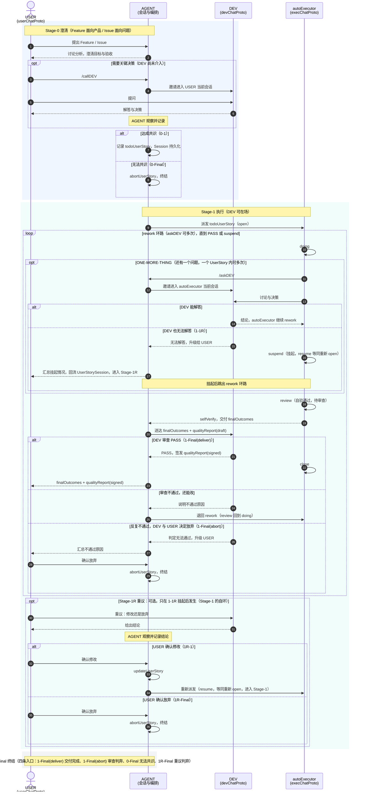

# MyEmbedAiNativeSWE::projectAgent(fromNewProject -> toNewProjectAgent)

> EVERY project will becoming a projectAgent
> WHICH means every triditional project will eventually evolve into a projectAgent


## 定义（Definition）

### defineGlossary（定义术语）

- 【WHO】：角色
  - **AGENT**：被打造和运维、被使用的智能体，即 `projectAgent`。
  - **DEV**：打造和运维 `AGENT` 的真人，对交付内容和质量负责的人。
  - **USER**：使用 `AGENT` 的一方角色，可以是真人也可是上层 `AGENT`。

- 【WHAT】：对象
  `AGENT` 由这些构成，也处理这些：
  - **System1**：`projectAgent` 自有的一部分，含 R+D+C 与 T+O+M。
  - **System2**：所有 `projectAgent` 共享的支撑层，分 business-oriented 与 infrastructure-oriented 两半。
  - **System3**：所有 `projectAgent` 共享的 LLM 推理，落地形态是 `modelHub`。
  - **agentRunner**：智能体的运行引擎，System2 的 R 构件，承载一个 service 与至少一个 executor。
  - **UserStory**：以一次交付为单位的工作项，有 todo / done / abort 三个主要状态。

### defineEquation（定义公式）

本节回答：`AGENT` 由什么组成。

- **AGENT** = **projectAgent**
  - =（`ModuleSourceAgent` 或 `FirmwarePackageAgent` 或 `AnyProjectAgent`）
    - 前两者即 microAgent 与 macroAgent；`AnyProjectAgent` 是它们的泛化
    - = `System1`（（R+D+C）+（T+O+M））
    - \+ `System2`（（KM/Skill+MCP+CAT）+（R+O+G+V））
    - \+ `System3`（LLM-D/P/A）
    - 每个 projectAgent 拥有自己的 System1；所有 projectAgent 共享 System2 和 System3。
  - `ModuleSourceAgent` 与 `FirmwarePackageAgent` 分别对应 micro 与 macro：前者交付模块，后者打包固件。
  - `AnyProjectAgent` 超出固件与模块之外，指任一类项目所对应的 projectAgent。只要一个项目能被切成 R+D+C 与 T+O+M，并且可以配上共享的 System2 与 System3，就可以用同一套定义承载。
- 参考PDF: [firstGlance_atProjectAgent](./PDFs/AI_Native_Embedded_Agent_Architecture.pdf)

> `嵌入式固件`由众多模块的成果在宏端到端（macro E2E）中**打包**而成。
> `模块`接收固件拆解后的需求，并在微端到端（micro E2E）中**交付**自己的成果。
> 固件与模块均经过架构化设计；固件通常按层级组织多个模块，模块之间功能各异。


### defineAgent（智能体角色定义）

以 `AGENT` 为中心：左侧是 DEV，右侧是 USER，底部是 `autoExecutor`，顶部是 Human(DEV/USER)-in-Loop。DEV、USER、`autoExecutor` 各经一条 chatProto 通道接入同一个 `AGENT`；顶部的介入层叠加在三条通道之上，靠虚线表示它不新开通道；底部虚线框把 `projectAgent` 与它的 `autoExecutor` 子智能体圈在一起，表示从属，不表示运行位置。

```text
┌─────────────────────────────────────────────────────────────────────────────────────────────────────────────────────┐
│  Human(DEV/USER)-in-Loop                                                                                            │
│  DEV 只在需要关键决策时入场，进入调用方已有的会话，不新开通道                                                       │
│  callDEV: USER 拉 DEV 进 userChatProto 会话                        askDEV: autoExecutor 拉 DEV 进 execChatProto 会话│
└─────────┬───────────────────────────────────────────────────────────────────────────────────────────────────────────┘
          ┊
          ┊
                                          ┌┄┄┄┄┄┄┄┄┄┄┄┄┄ AGENT ┄┄┄┄┄┄┄┄┄┄┄┄┄┐
┌────────────────────┐                    ┊ ┌─────────────────────────────┐ ┊                    ┌────────────────────┐
│        DEV         │                    ┊ │        projectAgent         │ ┊                    │        USER        │
│      (human)       │ ◄─ devChatProto ─► ┊ │       = System1 (own)       │ ┊◄─ userChatProto ─► │ (human or AGENT)   │
│                    │                    ┊ │        R+D+C / T+O+M        │ ┊                    │                    │
└────────────────────┘                    ┊ └──────────────┬──────────────┘ ┊                    └────────────────────┘
                                          ┊                │                ┊
                                          ┊          execChatProto          ┊
                                          ┊                ▼                ┊
                                          ┊   ┌───────────────────────┐     ┊
                                          ┊   │ autoExecutor #1 .. #N │     ┊
                                          ┊   │     (subAgent x N)    │     ┊
                                          ┊   └───────────────────────┘     ┊
                                          └┄┄┄┄┄┄┄┄┄┄┄┄┄┄┄┄┄┄┄┄┄┄┄┄┄┄┄┄┄┄┄┄┄┘
```

图中 chatProto 写在连线上：`DEV ◄─ devChatProto ─► AGENT ◄─ userChatProto ─► USER`，下方是 `AGENT │ execChatProto │▼ autoExecutor #1 .. #N`。底部虚线框就是 `AGENT`，它也是共享 `agentRunner` 的运行边界：框内有一个 `projectAgent` 本体与 N 个 `autoExecutor` 执行体，`autoExecutor` 是 projectAgent 的 subAgent，运行在 `agentRunner` 上（见 `defineSystem`），不在 projectAgent 内部。顶部横幅是 `topOfAgent`，即 `callDEV` / `askDEV` 的 Human(DEV/USER)-in-Loop；它用虚线挂到 DEV 框，表示入环的是人且不新开通道。`projectAgent` 只画自有部分，即 `System1`；`System2` 与 `System3` 由所有 projectAgent 共享，不属于这个节点，构件定义见 `defineSystem`。入环的具体时机见 `defineFlow`，规则见下方正文。


- **defineRole**：AGENT，DEV，USER
  - 三个角色：`AGENT` 是被使用的智能体，`DEV` 打造和运维它，`USER` 使用它。三者的身份不同，所以只有三个角色。
  - `autoExecutor` 不是角色：它是 `AGENT` 的执行体。`AGENT` 本体负责会话与编排，即 `projectAgent`；执行时把每个 UserStory 委托给一个 `autoExecutor`，所以可以有 N 个。
  - 归属：三套角色是**每个 `AGENT` 各有一套**的本地角色，所以 N 个 `AGENT` 就有 N 套 DEV / USER；只有 `System2` 与 `System3` 是全池共享。
  - chatProto 三通道：DEV 与 `AGENT` 之间只有 `devChatProto`，USER 与 `AGENT` 之间只有 `userChatProto`，`autoExecutor` 与 `AGENT` 之间只有 `execChatProto`。三条通道各自独立接入同一个 `AGENT`，互不混用。
  - chatProto 承载的协议：`devChatProto` 恒为自然语言会话，因为 DEV 一定是真人；`userChatProto` 依 USER 的身份而定，USER 是真人时为自然语言会话，USER 是 `AGENT` 时为 A2A；`execChatProto` 恒为 `AGENT` 之间的通信，可以是 A2A，也可以是私有协议。协议取决于对端是谁（真人还是 `AGENT`），不由通道决定。
  - agentProto：`chatProto` 说的是某条通路上跑什么协议，`agentProto` 说的是协议本身。A2A 是让两个或多个 `AGENT` 互相通信的协议，用于上层 `AGENT` 向下层 `AGENT` 派发需求、收成果。A2A 只是协议，不是任何 System 的构件。
- **leftOfAgent**（智能体左侧）：DEV 经 `devChatProto` 使用 `chatDEV` 打造和运维 projectAgent。
  - DEV：每个 `AGENT` 都有自己的 DEV，现实中至少有一位真人担任。DEV 是角色绑定而非人头计数，同一位真人可以同时担任多个 `AGENT` 的 DEV。
  - baseCodeAgent：DEV 经 `devChatProto` 使用的编码工具，可以、也应当充分复用既有的编码智能体，如 Copilot / Codex / …；也可以基于 CopilotSDK 自建 code agent。它属于 `leftOfAgent`，不在 `agentRunner` 上运行；`chatDEV` 只负责会话与编排，不重复实现编码能力。
- **rightOfAgent**（智能体右侧）：USER 经 `userChatProto` 使用 `chatUSER` 提出 Feature/Issue、讨论分析生成 todoUserStory、得到 finalOutcomes 和 qualityReport(signed)。
  - USER：每个 `AGENT` 也各有自己的 USER。上层 `AGENT` 对下层 `AGENT` 就是它们的 USER：macro 层的 USER 通常是真实的人，micro 层的 USER 是承接需求的上级 `AGENT`。在 USER 视角，落地端到端交付（E2E）。
  - Feature/Issue：Feature 面向产品，描述要新增的能力；Issue 面向问题，描述要修复的缺陷。二者都从 Stage-0 进入同一条流程。
  - Stage：共四段，编号 0 / 1 / 1R / Final。Stage-0 澄清，Stage-1 执行，Stage-1R（R = Re-discuss，重议）重议，Stage-Final 终结。每条跃迁都写作“物件 --> 物件”，冒号后说明触发条件。
    - Stage-1R 不是 Stage-1 的下一段，而是它的自环：只能由 Stage-1 进入，出边只有两条，回到 Stage-1 或进入 Stage-Final；本身不产出交付物。
    - Stage-1R 同时是 run 边界：一次 run 从派发 todoUserStory 开始，到 done 或 suspend 结束，重议发生在两次 run 之间。
    - 0-1：Feature/Issue --> todoUserStory：讨论达成共识，AGENT 记录。
    - 0-Final：Feature/Issue --> abortUserStory：无法达成共识，AGENT 终结；被放弃的 UserStory 作为 projectAgent 的记忆留存。
    - 1-Final(deliver)：todoUserStory --> finalOutcomes：selfVerify 且 DEV 审查 PASS，由 AGENT 经 `userChatProto` 交付，并附 qualityReport(signed)。
    - 1-1R：todoUserStory --> updateUserStory：autoExecutor 经 askDEV 仍无法解决，挂起，进入 Stage-1R 重议。
    - 1-Final(abort)：todoUserStory --> abortUserStory：审查反复不通过，DEV 判定并由 USER 确认放弃。
    - 1R-1：updateUserStory --> todoUserStory：重议后 USER 确认修改，重新派发，回到执行。
    - 1R-Final：updateUserStory --> abortUserStory：重议后 USER 确认放弃，不产出任何交付物。
  - Owner：todoUserStory 由 AGENT 生成。来源有两种：USER 单独讨论后确定，或经 callDEV 由 USER 与 DEV 达成共识后确定。
  - Report：qualityReport 是交付报告的统一名称，其中包含 verifiedReport（验证证据）。报告有两个状态：autoExecutor 自验后产出 `qualityReport(draft)`，DEV 审查 PASS 后签发为 `qualityReport(signed)`。只有 signed 版本可以交付 USER，因为 DEV 对交付质量负责。
  - Session：Session 指 USER 的 todoUserStory 会话，后文也称 UserStorySession。当进入 Stage-1，该会话会持久化，并用于后续阶段的讨论和交付。
- **topOfAgent**（智能体顶部）：不是第四条通道，而是叠加在三条通道之上的 Human(DEV/USER)-in-Loop 介入层。USER 或 autoExecutor 需要关键决策时，经 `callDEV` / `askDEV` 邀请 DEV 进入**调用方正在用的那条会话**，DEV 不新开通道。
  - 此时：USER 提问，DEV 解答，AGENT 观察；直到 USER 同意，AGENT 才将其记录为 todoUserStory；或者 USER 和 DEV 无法产生共识，则 abortUserStory。
  - 若经 `askDEV` 进入，则结论回到 autoExecutor：能解答就让 autoExecutor 继续 rework，不能解答就升级 USER（见 `bottomOfAgent`）。
- **bottomOfAgent**（智能体底部）：AGENT 经 `execChatProto` 把 todoUserStory 派发给 `chatEXECUTOR`。
  - autoExecutor：**自主执行**，与 DEV 的人工执行相对。一个 projectAgent 默认带一个服务实例与至少一个 executor，并按 todoUserStory 数量扩到 N 个；每个 autoExecutor 以 UserStory 为单位，完成 todo -> doing ⇄ review -> done 的闭环，abort 可从任一中间态进入。review 表示 autoExecutor 自验通过、等待 DEV 审查。`suspend` 不是独立状态，只是挂起等待，resume 时等同重新 open。落地形态是 subAgent 还是 multiAgent，实现时确定技术方案。
  - selfVerify：autoExecutor 自己验证通过，把 UserStory 从 doing 推到 review。这一步是本次 run 的执行终点。
  - 送审：推到 review 后，autoExecutor 把 finalOutcomes 与 `qualityReport(draft)` 交给 `AGENT` 送审。全程不需要 USER 介入裁决。
  - 交付审查：autoExecutor 的 finalOutcomes 与 `qualityReport(draft)` 经 AGENT 送达 DEV 审查。PASS 时 DEV 签发 `qualityReport(signed)`，UserStory 进入 done，AGENT 经 `userChatProto` 交付 USER。不通过时两条路：还能改就退回 autoExecutor rework，即 review 回到 doing；反复不通过则由 DEV 判定并升级 USER，USER 确认放弃后 abortUserStory 终结。autoExecutor 侧经 askDEV 仍无解时则挂起。
  - ONE-MORE-THING（还有一个问题）：当 autoExecutor 在过程里遇到无法自主解决的问题时，先经 askDEV 把请求交给 AGENT，再由 AGENT 邀请 DEV 进入 **autoExecutor 当前的 execChatProto 会话**，进行讨论和决策。DEV 不新开会话。一个 UserStory 里 autoExecutor 可以多次 askDEV。
  - askDEV 的两种结局，每次调用二选一：DEV 知道怎么答，就把结论给 autoExecutor，autoExecutor 继续 rework，之后还可以再次 askDEV；DEV 也不知道怎么答，就结束 askDEV 循环，把问题升级给 USER，autoExecutor 挂起当前 UserStory，由 AGENT 汇总后回流 USER 的 UserStorySession，进入 Stage-1R。Stage-1R 重议确认修改后，UserStory 重新 open（等同 resume），重新派发。


### defineFlow（USER 与 AGENT 时序）

从 USER 与 AGENT 的视角看，上面四个方位如何串成一次交付。各阶段用底色分隔，消息里的编号对应 `rightOfAgent` 下的 Stage 跃迁。




### defineSystem（系统定义）

下面这张图回答三个问题：谁拥有谁，谁共用谁，谁依赖谁。每个 projectAgent 把 System1 装在自己身体里；System2 与 System3 放在外面，由所有 projectAgent 共用。依赖有三条：System1 走 System2（business-oriented 支撑业务，infrastructure-oriented 提供运行与治理基座）；System1 也可直接调用 System3；System2 自身也重度依赖 System3。

```text
┌──────────────────────────────────────────┐        ┌──────────────────────────────────────────┐
│ projectAgent #1                          │        │ projectAgent #N                          │
│                                          │        │                                          │
│  ┌────────────────────────────────────┐  │        │  ┌────────────────────────────────────┐  │
│  │ System1 (own)                      │  │        │  │ System1 (own)                      │  │
│  │                                    │  │        │  │                                    │  │
│  │ R+D+C  SPEC   youWantR             │  │        │  │ R+D+C  SPEC   youWantR             │  │
│  │               iWhyD + aiHowC       │  │        │  │               iWhyD + aiHowC       │  │
│  │ T+O+M  Harness  Tools              │  │        │  │ T+O+M  Harness  Tools              │  │
│  │               Orchestration        │  │        │  │               Orchestration        │  │
│  │               Memory               │  │        │  │               Memory               │  │
│  └────────────────────────────────────┘  │        │  └────────────────────────────────────┘  │
└─────────────────────┬────────────────────┘        └─────────────────────┬────────────────────┘
                      │                                                   │
                      │                                                   │
                      └─────────────────────────┬─────────────────────────┘
                                                │ System1 uses:
                          ┌─────────────────────┴─────────────────────────────┐
                          │ System2 business + infra                          │ modelHub direct
                          │                                                   │
                          ▼                                                   ▼
┌──────────────────────────────────────────────────┐        ┌──────────────────────────────────┐
│ System2  (shared by all projectAgents)           │        │ System3  = modelHub              │
│                       │                          │        │                                  │
│ business-oriented     │ infrastructure           │        │ modelHub: LLM service            │
│   KM/Skill  GraphRAG  │ R  agentRunner           │        │                                  │
│   MCP       legacy    │ O  Observation           │ ─────▶ │ [D] codeGenReasoningDeepest      │
│   CAT       CI/CD     │ G  Governance            │        │ [P] codeGenReasoningLatest       │
│             unit/sys  │ V  Verification          │        │ [A] codeGenLatest                │
│ R  agentRunner = 1    │ projectAgent             │        │ serves Sys1 and Sys2             │
└──────────────────────────────────────────────────┘        └──────────────────────────────────┘
```

- **Sys1**@【R+D+C】：需求+设计+代码（Requirements+Design+Code）
  - 传统上：R 以口头、邮件或表格形式存在，没有分析记录；D 至少、至多是分层或模块化，缺乏 DFX 或质量属性的考量；C 是唯一的、也只是“可能可用”的产物。
  - 如今：SPEC=youWantR（你要什么）+iWhyD（我为什么这样设计）+aiHowC（AI 如何实现）
- **Sys1**@【T+O+M(Harness)】：工具调用/斜杠命令/技能（ToolCalls/slashCommands/Skills）+编排/工作流（Orchestration/WorkFlow）+短期/长期记忆与有效上下文窗口（short/LongMemory/effectiveContextWindow）
- **Sys2**@【KM/Skill+MCP+CAT(Harness)】（business-oriented，支撑 System1 的业务）：知识管理（KnowledgeManagement）+MCP-遗留服务（MCP-LegacyService）+持续自动测试（ContinueAutomaticTesting）
  - KM 本质上基于语义搜索；GraphRAG 用于精准生成；Skill 用于共享可运行的战术技巧
  - CAT 是 CI/CD 的执行体，在真实/仿真硬件上跑单元测试/系统测试/用户测试（unitTesting/sysTesting/userTesting）。
- **Sys2**@【R+O+G+V】（infrastructure-oriented，提供运行与治理基座）：agentRunner+观测（Observation）+治理（Governance）+验证（Verification）
  - R 是 agentRunner，即智能体的运行引擎。它运行两类实例：每个 projectAgent **一个服务实例**，承载该 `AGENT` 的 `Sys1@T+O+M` 与共享的 Sys1 工作区；以及该 projectAgent 名下的**多个 autoExecutor 子智能体实例**，每个实例服务一个 UserStory。同一服务实例下的多个 autoExecutor 实例并行推进，不直接改同一份 Sys1 工作区，冲突由 G 的策略拦截。
  - G 在这里指规则的强制执行（策略与审计），不是组织管理；O 与 V 提供遥测与验证证据。
- **Sys3**@【LLM-D/P/A】：具备深度思考（DeepThinking）、规划（Planning）或行动（Acting）能力的 LLM 推理——分别用于复杂问题分析、复杂任务规划、清晰任务执行。
  - System3 的落地形态就是 **modelHub**：一个对外提供 LLM 服务的模型中心。
  - 我们将其命名为：codeGenReasoningDeepest, codeGenReasoningLatest, codeGenLatest
  - System1 可以直接调用 System3，不必经过 System2；System2 自身也重度依赖 System3。System2 与 System3 都由所有 projectAgent 共用。

## 落地（Realization）

- **[projectAgentFramework](../projectAgentFramework/README.md)**：打造与迁移框架——支撑 `newProjectAgent`（正向新建）与 `portProjectAgent`（存量演进），沉淀统一的 `Sys1` 骨架、协议契约与底座连接器。
- **[projectAgentRunner](../projectAgentRunner/README.md)**：`agentRunner`（`Sys2@R`）的具体实现——作为全池共享的运行引擎，承载每个 `projectAgent` 的 `1 service + 1..N autoExecutor` 实例并硬化 `O+G+V` 治理。
